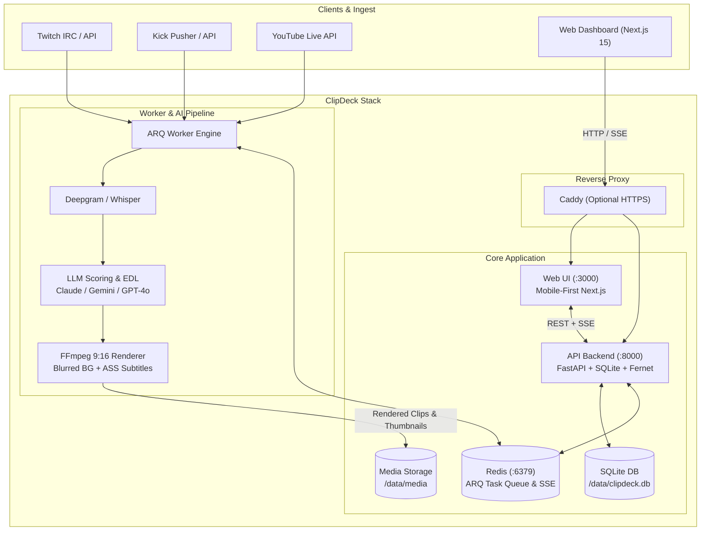

# ClipDeck 🎬⚡

> **Self-hosted, real-time live-stream hype detection & AI clipping engine.**  
> Monitor live streams across Twitch, Kick, and YouTube, detect peak moments automatically using statistical chat velocity & sentiment signals, and transform raw moments into viral 9:16 vertical clips with AI scoring, hierarchical playbooks, and deterministic FFmpeg rendering.

---

## Table of Contents
1. [Overview](#overview)
2. [Platform Capabilities](#platform-capabilities)
   - [Phase 1: Ingest & Real-Time Hype Detection](#phase-1-ingest--real-time-hype-detection)
   - [Phase 2: AI Editing, Playbooks & Vertical Rendering](#phase-2-ai-editing-playbooks--vertical-rendering)
3. [Architecture](#architecture)
4. [Quick Start](#quick-start)
5. [Developer Account Setup](#developer-account-setup)
   - [Twitch](#twitch)
   - [Kick](#kick)
   - [Google / YouTube](#google--youtube)
   - [AI Providers (Anthropic, OpenAI, Gemini, OpenRouter, Deepgram)](#ai-providers)
6. [Configuration Reference](#configuration-reference)
7. [Testing, Replay & AI Pipeline Simulation](#testing-replay--ai-pipeline-simulation)
   - [Live Chat Replay](#live-chat-replay)
   - [Phase 2 AI Pipeline & 9:16 FFmpeg Rendering](#phase-2-ai-pipeline--916-ffmpeg-rendering)
8. [Production Deployment](#production-deployment)
9. [Known Limits & Roadmap](#known-limits--roadmap)

---

## Overview

ClipDeck is a self-hosted platform built for content creators, stream editors, and clipping channels. Instead of manually watching hours of VODs, ClipDeck continuously ingests live chat streams and audio levels, analyzes statistical surges in activity (EWMA, z-scores, emote bursts, copypastas, sub bombs), captures low-latency video segments into an in-memory ring buffer, and automatically extracts high-impact clips.

In Phase 2, ClipDeck introduces **AI-powered editorial automation**: moments are transcribed, evaluated against customized multi-tiered playbooks, structured into machine-readable Edit Decision Lists (EDLs), and rendered into 1080x1920 (9:16) vertical videos formatted for TikTok, YouTube Shorts, and Instagram Reels with Subtle animated motion captions (39 styles: punch, glide, terminal, glass, keyword, impact, etc.) and blurred background layouts.

---

## Platform Capabilities

### Phase 1: Ingest & Real-Time Hype Detection
- **Multi-Platform Monitoring:** Twitch (IRC/WebSocket), Kick (Pusher/WebSocket), and YouTube Live (Chat Polling).
- **Hype Detection Algorithm:** Multi-signal mathematical model featuring EWMA velocity, rolling Median Absolute Deviation (MAD), z-score statistical surge detection, hype emote density, copypasta detection, sub/gift bursts, and audio RMS loudness bonus.
- **Circular Video Ring Buffer:** 15-minute rolling window stored on disk with automatic age & capacity pruning.
- **REST & Real-Time API:** FastAPI backend with JWT session auth, TOTP 2FA, Fernet key encryption, and Server-Sent Events (SSE) for zero-latency dashboard updates.
- **Responsive Web Dashboard:** Next.js 15, Tailwind CSS, Lucide icons, Dark/OLED theme, live stream monitoring, moments review, and system health status.

### Phase 2: AI Editing, Playbooks & Vertical Rendering
- **Hierarchical Playbooks:** Multi-tier rule merging (`Global` → `Category` → `Streamer` → `Target`) with strict enforcement of hard constraints ("never clip minors, gambling, or DMCA music").
- **AI Moment Scoring:** LLM analysis (Gemini 2.5 Flash, Claude 3.5 Sonnet, GPT-4o) of transcripts + chat reaction spikes to grade virality (0-100), identify hooks, and detect rule violations.
- **Pydantic-Validated EDL Generator:** Automatic assembly of Edit Decision Lists specifying cut intervals, hook overlays, zoom punches, and subtitle styles with self-healing schema retry loops.
- **Deterministic 9:16 FFmpeg Renderer:** Hardware-efficient transformation of 16:9 gameplay into 1080x1920 vertical format utilizing blurred background styling (`boxblur`, brightness attenuation) or facecam splits.
- **Subtle Animated Motion Captions:** 39 broadcast-quality animated caption styles powered by Subtle (https://github.com/0xpratzyy/subtle) with word-level highlights, number normalization ($5,000, 40%), intelligent clause grouping, and AI emphasis burned directly into video or exported as sidecars.
- **Spend & Budget Caps:** Daily and monthly expenditure safety controls with real-time token ledger tracking to prevent runaway API costs.

---

## Architecture



---

## Quick Start

### 1. Prerequisites
- [Docker](https://docs.docker.com/get-docker/) & Docker Compose (v2.20+)
- Python 3.11+ (optional, for local development and offline scripting)
- FFmpeg 6.0+ (installed in worker container; required locally for standalone CLI testing)

### 2. Clone the Repository
```bash
git clone https://github.com/your-org/clipdeck.git
cd clipdeck
```

### 3. Configure Environment
```bash
cp .env.example .env
```

Generate security secrets for credential encryption and session auth:
```bash
# Generate Fernet Master Key for encrypted provider credentials:
python3 -c "from cryptography.fernet import Fernet; print(Fernet.generate_key().decode())"

# Generate JWT Secret:
python3 -c "import secrets; print(secrets.token_urlsafe(32))"
```

Open `.env` and set `CLIPDECK_MASTER_KEY` and `JWT_SECRET` with the generated values.

### 4. Start with Docker Compose
```bash
docker compose up --build
```

### 5. Access the Platform
- **Dashboard:** [http://localhost:3000](http://localhost:3000)
- **FastAPI Interactive Docs:** [http://localhost:8000/docs](http://localhost:8000/docs)
- **API Health Check:** [http://localhost:8000/api/health](http://localhost:8000/api/health)

### 6. Initial Login
- **Username:** `admin`
- **Password:** `changeme`
*(On first login, you will be prompted to update your password and optionally configure TOTP two-factor authentication).*

---

## Developer Account Setup

Configure platform credentials under **Settings → API Keys** in the dashboard or via `.env`.

### Twitch
1. Navigate to the [Twitch Developer Console](https://dev.twitch.tv/console).
2. Click **Register Your Application**.
3. Name: `ClipDeck`, OAuth Redirect: `http://localhost:8000/api/auth/twitch/callback`.
4. Copy your **Client ID** and generate a **Client Secret**.
5. **Chat Bot Account:** Create a dedicated Twitch account for your bot reader and generate an OAuth token at [Twitch Chat OAuth Generator](https://twitchapps.com/tmi/) with `user:read:chat` scope.

### Kick
1. Navigate to the [Kick Developer Portal](https://kick.com/developer).
2. Register your application and set Webhook URL: `https://your-domain/api/webhooks/kick`.
3. Note **App ID**, **API Key**, and **Webhook Secret**.

### Google / YouTube
1. Go to the [Google Cloud Console](https://console.cloud.google.com).
2. Enable **YouTube Data API v3**.
3. Create OAuth 2.0 Credentials (Web application) with redirect URI: `http://localhost:8000/api/auth/google/callback`.

### AI Providers
For transcription, moment scoring, and EDL generation, configure one or more keys:
- **Deepgram:** [https://console.deepgram.com](https://console.deepgram.com) (Recommended for ultra-fast, word-level audio transcription).
- **Anthropic:** [https://console.anthropic.com](https://console.anthropic.com) (`claude-3-5-sonnet-20241022` for precision EDL editing).
- **Google Gemini:** [https://aistudio.google.com](https://aistudio.google.com) (`gemini-2.5-flash` for high-speed, cost-effective moment scoring).
- **OpenAI:** [https://platform.openai.com](https://platform.openai.com) (`gpt-4o-mini` for metadata and title generation).
- **OpenRouter:** [https://openrouter.ai](https://openrouter.ai) (Universal routing across open-source and proprietary models).

---

## Configuration Reference

| Environment Variable | Default Value | Description |
|---|---|---|
| `CLIPDECK_MASTER_KEY` | *(Required)* | 32-byte Fernet key used to encrypt provider credentials at rest. |
| `JWT_SECRET` | *(Required)* | Secret key used to sign HS256 JWT access and refresh tokens. |
| `DATABASE_URL` | `sqlite:///./data/clipdeck.db` | Database connection URI (auto-normalizes for async SQLite). |
| `REDIS_URL` | `redis://redis:6379/0` | Redis connection URL for task distribution and pub/sub. |
| `MEDIA_PATH` | `/data/media` | Directory where ring buffer video segments and saved clips reside. |
| `RING_BUFFER_MAX_MINUTES` | `15` | Maximum sliding window duration stored in circular buffer. |
| `RING_BUFFER_DISK_CAP_GB` | `50` | Maximum disk storage allocation before segment pruning. |
| `MAX_CONCURRENT_STREAMS` | `4` | Maximum parallel live stream recording processes per worker. |
| `AI_SCORING_PROVIDER` | `gemini` | AI provider for virality grading (`gemini`, `anthropic`, `openai`). |
| `AI_SCORING_MODEL` | `gemini-2.5-flash` | Specific LLM model for virality scoring. |
| `AI_EDL_PROVIDER` | `anthropic` | AI provider for Edit Decision List generation. |
| `AI_EDL_MODEL` | `claude-3-5-sonnet-20241022` | Model for structural EDL creation. |
| `TRANSCRIPTION_PROVIDER` | `deepgram` | Word-level transcription service (`deepgram`, `whisper`). |
| `DAILY_SPEND_CAP_DOLLARS` | `15.00` | Daily spend ceiling in USD before AI tasks pause. |
| `ENABLE_HARD_BUDGET_CAP` | `true` | Enforce strict rejection of AI tasks exceeding spend caps. |
| `ADMIN_USERNAME` | `admin` | Default administrative account username. |
| `ADMIN_PASSWORD` | `changeme` | Default initial admin password (force-rotated on first access). |

---

## Testing, Replay & AI Pipeline Simulation

ClipDeck includes an offline testing harness to evaluate both the statistical hype detector and the full Phase 2 AI rendering pipeline without requiring active live streams.

### Live Chat Replay
Simulate an active live stream chat with real-time ASCII velocity meters and peak detection alerts:
```bash
# Accelerated chat replay test:
docker compose exec worker python -m seed.seed --replay --speed 2.0
```
- Ingests `seed/demo_chat.jsonl` (620+ synthetic messages simulating baseline chat, major spike at msg 200, cooldown, and copypasta burst at msg 400).
- Calculates rolling EWMA, dynamic MAD baseline, and statistical z-scores.
- Emits detected moment triggers with chat snapshots into the database.

### Phase 2 AI Pipeline & 9:16 FFmpeg Rendering
Run the end-to-end AI editorial pipeline simulation:
```bash
# Execute within worker container:
docker compose exec worker python -m seed.seed --pipeline

# Or run locally with Python:
python3 -m seed.seed --pipeline
```

#### Pipeline Steps Executed:
1. **Playbook Bootstrapping:** Loads `viral_moments.md` (Global), `gaming_clips.md` (Category: Gaming), and `irl_clips.md` (Category: IRL) into SQLite.
2. **Moment Selection:** Retrieves the top-scoring detected moment from chat analysis.
3. **Word-Level Transcription:** Simulates Deepgram Whisper audio alignment with word timestamps.
4. **AI Virality Scoring:** Grades clip quality (Score: 94.5/100, Tier S), generates hook text, and verifies rule compliance.
5. **EDL Generation:** Formats cut boundaries, hook text overlays, and 1080x1920 layout instructions.
6. **FFmpeg 9:16 Render:** Executes deterministic FFmpeg commands to produce `seed/test_clip.mp4` with blurred background and Subtle animated motion captions.
7. **Database Persistence:** Inserts rendered `Clip` and thumbnail into `clips` table.

---

## Production Deployment

For internet-facing deployments with automated TLS/HTTPS via Let's Encrypt:

1. Point your domain's DNS `A` / `AAAA` records to your server IP.
2. In `.env`, set:
   ```bash
   DOMAIN=clipdeck.yourdomain.com
   ```
3. Run with the production compose overlay:
   ```bash
   docker compose -f docker-compose.yml -f docker-compose.prod.yml up -d
   ```

Caddy will listen on ports `80` and `443`, provision TLS certificates automatically, route `/api/*` traffic to the FastAPI backend, and route web traffic to the Next.js frontend.

---

## Known Limits & Roadmap

- **Database:** SQLite is used in Phase 1 & 2 for zero-configuration portability. Transition to PostgreSQL is planned for enterprise clustering.
- **Phase 3:** Interactive web timeline editor, face-tracking crop box smoothing, animated kinetic captions.
- **Phase 4:** Direct social media publishing (TikTok API, YouTube Data API v3, Meta Graph API) with multi-account scheduling and performance analytics.

---

## License

Proprietary & Confidential. Built for internal content automation.
