# Subtle

Animated captions for talking-head video, rendered locally.

Subtle is a skill for Codex and Claude Code, with a standalone CLI. Give it a video to transcribe and animate
captions in one of 35 styles. It runs on your machine without uploading the footage or asking for an API key.

**See every style on a real clip: https://subtle.refs.video** (the showcase site runs the same caption engine in the
browser; its source is in `site/`).

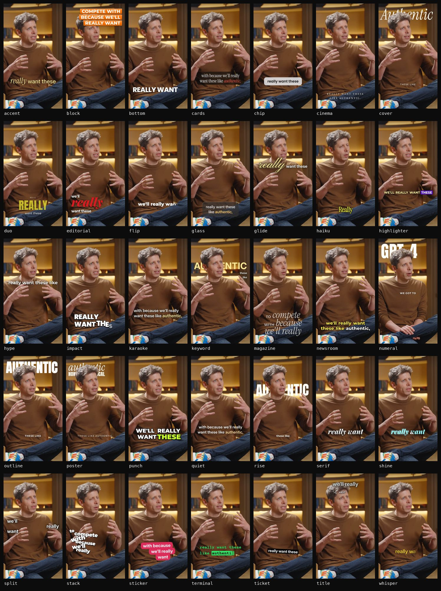

All 35 styles on the same frame. Every one runs live at https://subtle.refs.video.

Demo frames: Sam Altman on David Senra's podcast (https://www.youtube.com/watch?v=kG8AoExkX40), used only to show captions; not affiliated with or endorsed by Sam Altman, OpenAI or the show.

## Smart highlights

Say "the gold price is five thousand dollars" and the caption shows **$5,000**, highlighted, in one piece.

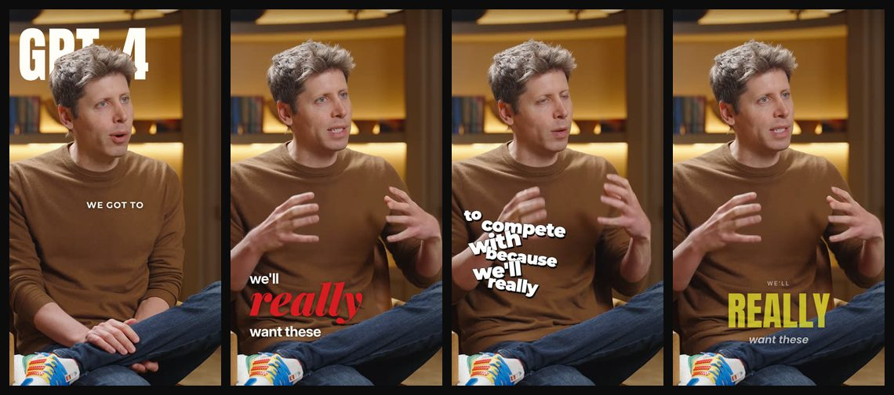

- **The words that matter get the highlight.** Numbers, prices, percentages and dates first, then names and places, then
  the punchline word, then the topic the first time it comes up. Claude reads your captions and picks them, with a
  one-line reason for each that you can read and change. One highlight per page, two on long pages, never filler words.
- **Numbers are written the way you would write them.** "five thousand dollars" and "$5000" become `$5,000`; "forty
  percent" becomes `40%`; "one lakh rupees" becomes `₹1 lakh`; years stay `1991`. An amount is one token: it is never
  split across two lines or two pages. Indian digit grouping (`₹15,00,000`) is used for rupee amounts and Hindi speech.
- **Every style has its own highlight**: a serif italic, a colour, an inverted chip, a second block colour, the giant
  word behind the speaker. A highlighted page also stays on screen a beat longer when there is room.
- **It works with no one picking, too.** Rules find the numbers, names and contrast words (`--emphasis auto`, the
  default). `--emphasis numbers` keeps only numbers, `--emphasis off` turns highlights off, and
  `--emphasis-words 'gold, $5,000'` forces words.

## Newer in v2

- **Text behind the speaker, per shot.** Six styles (`keyword`, `cover`, `outline`, `poster`, `rise`, `numeral`) put the
  giant word behind the person. Subtle checks every shot on its own: in a wide shot the word goes behind the head, in a
  close-up (where it would be hidden) it is drawn in front or skipped. Needs macOS (Apple Vision cut-out).
- **Smart placement.** Each page moves off the face and the hands, inside the style's allowed range, and only when it has
  to (`--placement auto`, the default; `off` keeps the style's own position).
- **Cut-aware pages.** Hard cuts are found with ffmpeg and no page straddles one (`--cuts auto`; `off` ignores cuts).
- **Automatic legibility.** Subtle measures what is behind every page and adds a soft halo, scrim or outline only where
  the type would not read. Clean dark footage is left untouched (`--legibility auto`; `off` draws the preset as it is).
- **Palette from the footage.** Styles with an accent colour take one that suits the scene and reads on it
  (`--palette auto`; `off` uses the preset's colours).
- **Recipe styles.** One generic style driven by a `recipe` block in the style JSON, so a new caption treatment needs
  no new TSX (see `docs/ARCHITECTURE.md`).

## What it does

1. Transcribes the speech with word-level timing (Whisper large-v3-turbo through `mlx-whisper`).
2. Writes spoken numbers as single tokens (`$5,000`, `40%`, `₹1 lakh`), groups the words into short, readable pages
   and highlights the words that matter.
3. Renders the captions in the style you pick, at the video's own size and frame rate.
4. With a behind-the-speaker style (`keyword`, `cover`, `outline`, `poster`, `rise`, `numeral`), cuts the speaker out with Apple Vision and puts the giant word behind them, shot by shot.
5. Moves pages off faces and hands, keeps them clear of cuts, and adds a halo or scrim where the footage would hide the type.
6. Checks the result (safe area, contrast, how much of each big word is visible) and makes a contact sheet.

You get `<name>.captioned.mp4`, `<name>.srt`, `<name>.captions.json` (editable) and `<name>.preview.jpg`.

## Install

**Codex**:

```bash
git clone https://github.com/0xpratzyy/subtle ~/.agents/skills/subtle
```

**Claude Code**:

```bash
git clone https://github.com/0xpratzyy/subtle ~/.claude/skills/subtle
```

Then ask your agent to *"add captions to ~/Movies/talk.mp4"* or *"put a giant keyword behind me"*.
For the standalone CLI, clone the repo anywhere and run the commands below from that directory.

## Requirements

| Need | For | Install |
|---|---|---|
| macOS on Apple Silicon | transcription (`mlx-whisper`) and the behind-the-speaker effect (Apple Vision) | |
| ffmpeg | reading and writing video | `brew install ffmpeg` |
| Node 18 or newer | the caption renderer | `brew install node` |
| Python 3.9 or newer and `uv` | transcription and visual checks | `brew install uv` |
| Swift (Xcode command line tools) | the behind-the-speaker styles and smart placement | `xcode-select --install` |

`bash scripts/doctor.sh` checks all of this and prints what is missing. The first run downloads the speech model (about
1.6 GB) and installs the renderer's packages (about a minute). On Linux or Intel Macs you can still render captions
from your own word timings (`--words`). Run `bash scripts/doctor.sh --from-timings` for this workflow.
Without `uv`, install `mlx-whisper` for transcription and `numpy` and `pillow` for visual checks
in the Python environment that runs Subtle.

## Styles

35 caption styles. Six of them (*behind you*) put the giant word behind the speaker, decided per shot (macOS for the person cut-out).

|  |  |  |  |
|---|---|---|---|
| 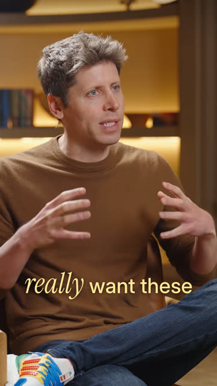<br>**accent**<br>Pale-lime sans in very short pages, with the key word in a light serif italic; soft fade with a small drift. | 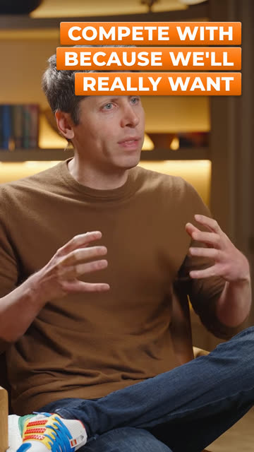<br>**block**<br>Every line in its own warm coloured block with depth; lines rise in with motion blur and pile up as a stack. | 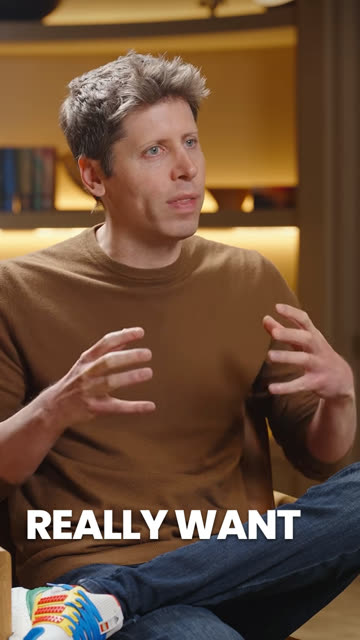<br>**bottom**<br>Big bold caps low in the frame that build word by word with no animation; the key word is yellow. | 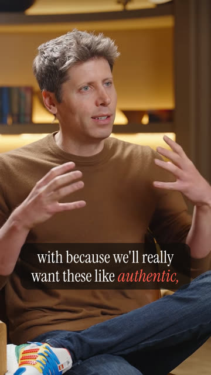<br>**cards**<br>White serif on a dark rounded card; the phrase appears at once, key words in red. The essay and serif-card look. |
| 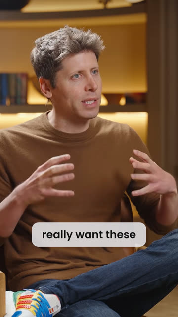<br>**chip**<br>A light rounded chip that hugs the page; words turn from grey to black as they are spoken. | 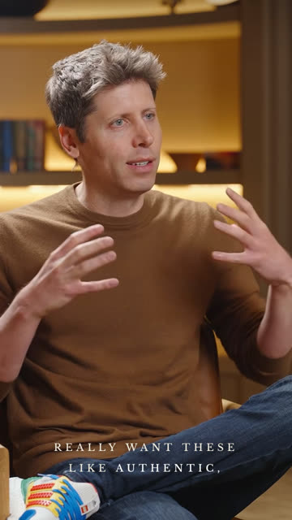<br>**cinema**<br>Tiny, wide-tracked serif capitals low in the frame that fade in and out slowly, like the subtitles of an arthouse trailer. | 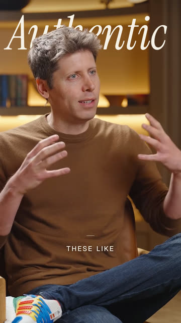<br>**cover** *(behind you)*<br>One huge serif italic word behind the speaker's head, like a magazine masthead; the rest of the line small and tracked in front. | 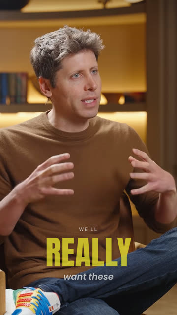<br>**duo**<br>A big condensed caps headline word with a tiny spaced-out lead-in above and a bold italic tail below. The lead-in fades in, the headline cuts in, the tail fades in. |
| 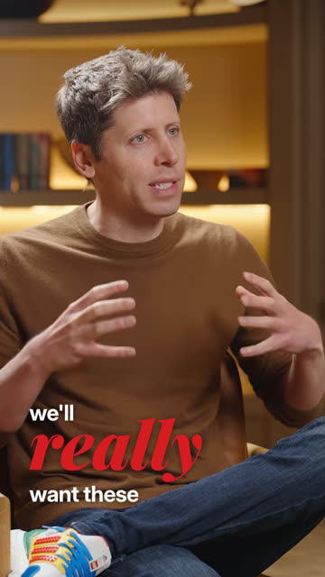<br>**editorial**<br>A bold sans lowercase line with the keyword set about three times larger in a high-contrast italic serif in cinema red, overlapping the sans. Lower-left third. | 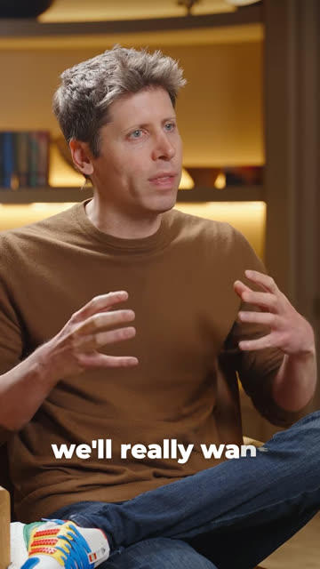<br>**flip**<br>Every letter flips in like a split-flap tile, turning edge-on and settling upright with a motion-blur trail. | 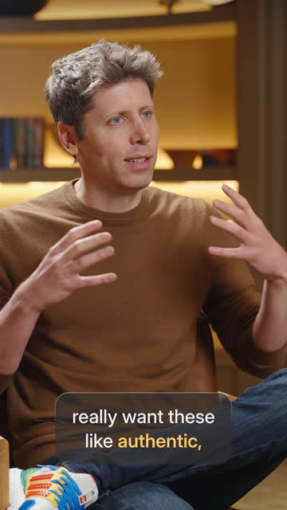<br>**glass**<br>One frosted-glass pill per page in soft lowercase; upcoming words are dim and brighten as they are spoken. | 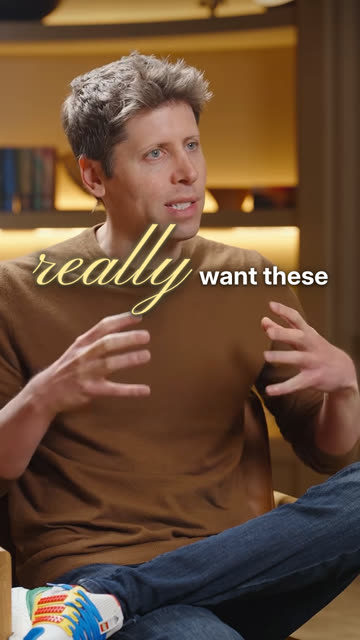<br>**glide** (default)<br>Key words in a large calligraphic script, the small words in bold white sans, on one baseline. |
| 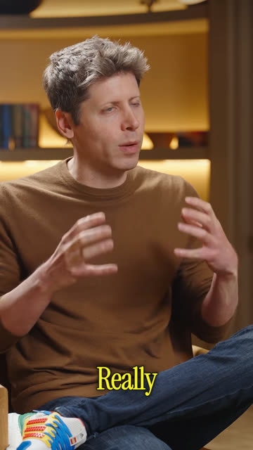<br>**haiku**<br>One small condensed serif word at a time in acid yellow. Hard cuts, no box. A hot word turns italic and a lighter yellow. | 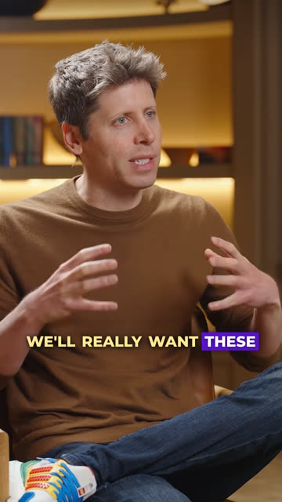<br>**highlighter**<br>Bold caps with one flat box behind the word being spoken, hopping from word to word. A finished word turns lime; the hot word comes alone, large. | 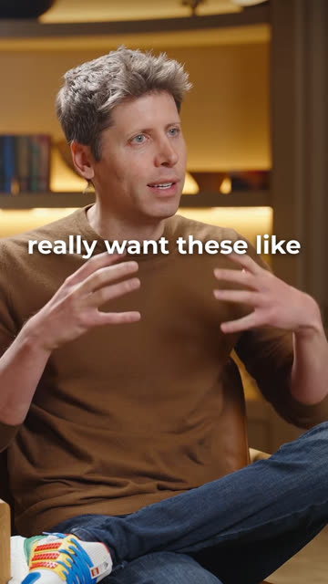<br>**hype**<br>A calm medium-weight line in soft white with a gentle shadow; the key word turns warm yellow. Hard cut in, no outline. | 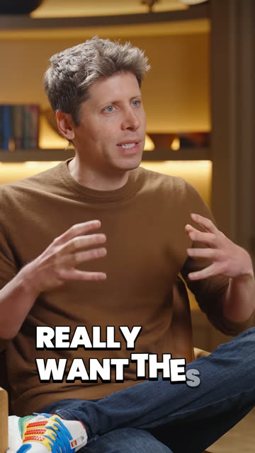<br>**impact**<br>Heavy round caps; every letter bounces in along an arc with overshoot and a little tilt, on a hard offset shadow. |
| 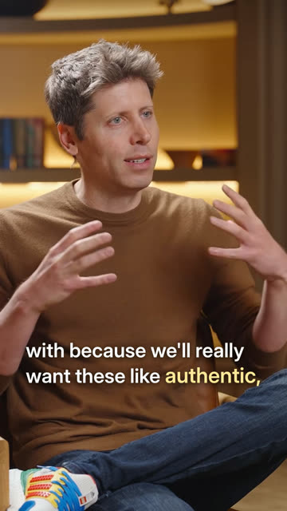<br>**karaoke**<br>The whole line shows dim; each word turns solid as it is spoken. One weight, no motion. | 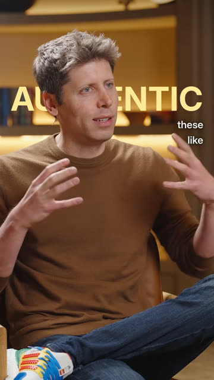<br>**keyword** *(behind you)*<br>One giant pale-lime keyword behind the speaker, the other words small and stacked beside it. | 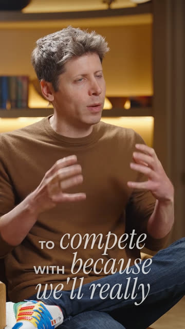<br>**magazine**<br>A tight justified block like an ad super: keywords in big serif italic, glue words in small grotesk capitals, every line the same width. | 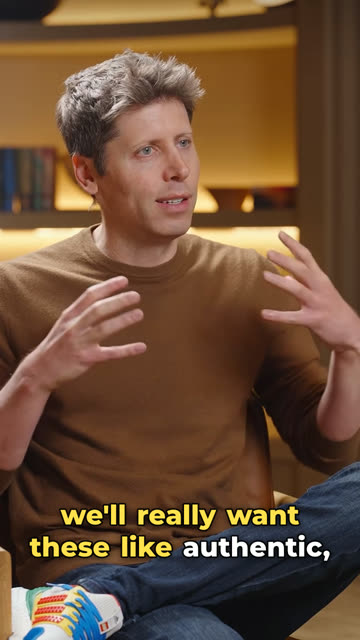<br>**newsroom**<br>Bold yellow sans, every word on screen at once, the word being spoken turns white; soft black outline, lower third. The news-explainer look. |
| 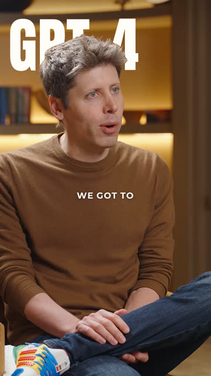<br>**numeral** *(behind you)*<br>Numbers, years and names go giant behind the speaker, digits rolling into place like an odometer; everything else stays small in front. | 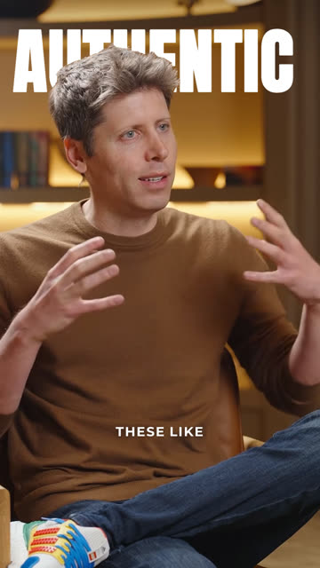<br>**outline** *(behind you)*<br>A giant hollow word behind the speaker that draws on, then fills with colour as it is spoken; a small bold line in front. | 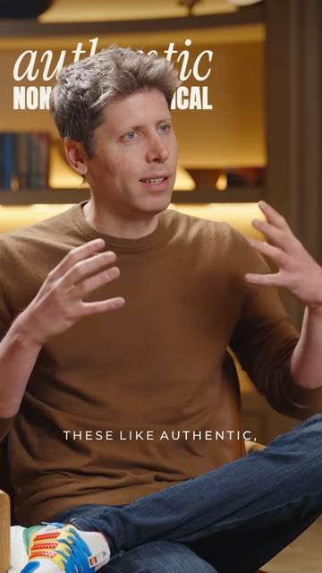<br>**poster** *(behind you)*<br>Two or three words stacked behind the speaker, each line a different face fitted to the same width, like a film poster's title block. | 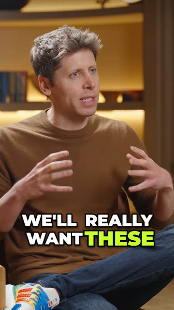<br>**punch**<br>Heavy upper-case sans that pops in word by word with overshoot; the spoken word swells and turns lime, thick black outline. The short-form creator look. |
| 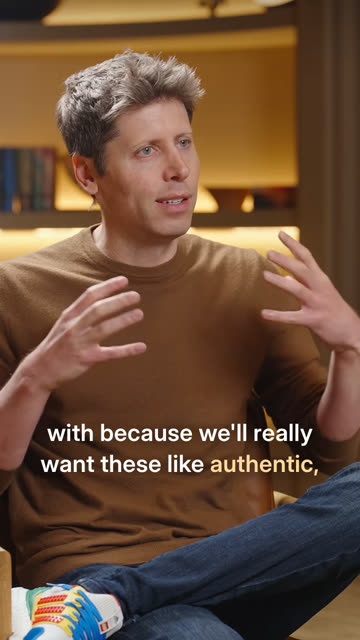<br>**quiet**<br>Lowercase medium sans, each line rises gently into place; no box, a refined soft shadow. The premium brand-film look. | 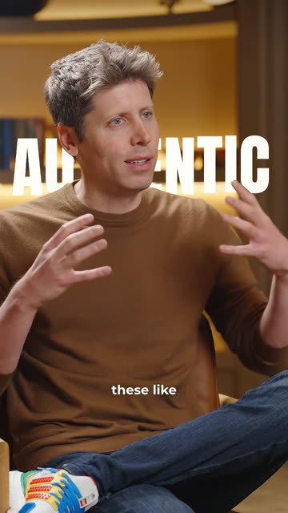<br>**rise** *(behind you)*<br>The giant word climbs out from behind the speaker's shoulders letter by letter, and sinks back when the word is done. | 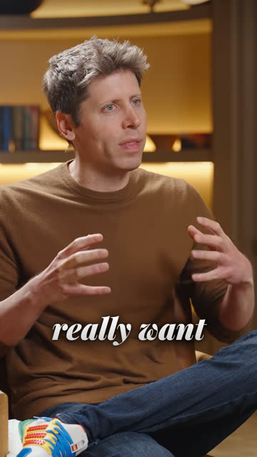<br>**serif**<br>Display serif italic filled with a top-lit silver gradient; quiet and luxurious. | 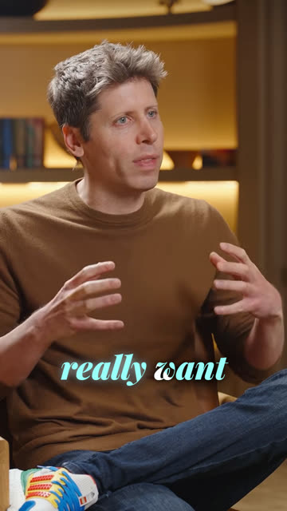<br>**shine**<br>Serif italic in one accent colour; a diagonal band of light sweeps across each word, then a soft glow fades. |
| 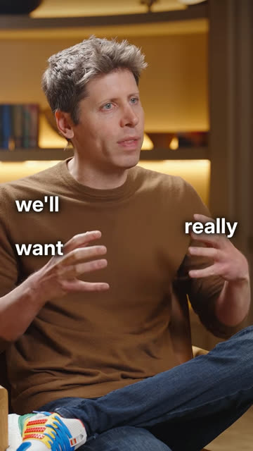<br>**split**<br>Words alternate to the two sides of the speaker and step down around the head like a staircase, never over the face. | 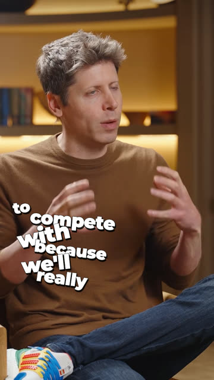<br>**stack**<br>A tilted, overlapping pile of words, each at its own size and angle, key words in yellow; the tilt mirrors on alternate pages. | 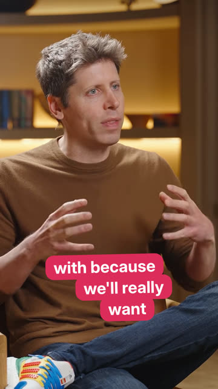<br>**sticker**<br>Rounded pink bubbles, one per line, each new line offset to the right of the last and stacked like typed messages; the stack tilts a little more on every page. Words are dark until spoken, then white. | 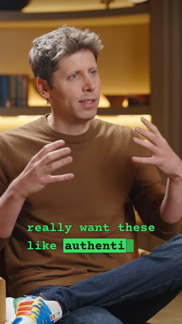<br>**terminal**<br>Green monospace typed character by character with a blinking block cursor. |
| 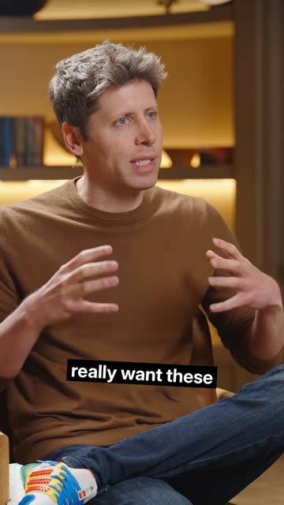<br>**ticket**<br>A hard-edged label tight around the text, tilted a different angle on every page. The hot word sits alone on a big label, filler phrases on a small one. Hard cuts. Colourway: yellow. | 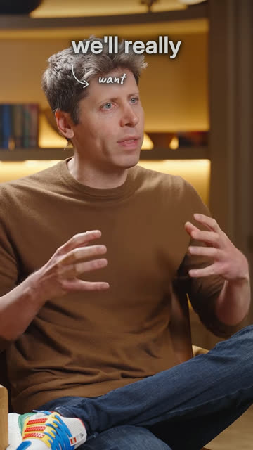<br>**title**<br>A typed title whose letter spacing collapses as the letters arrive, with a small handwritten note under it. | 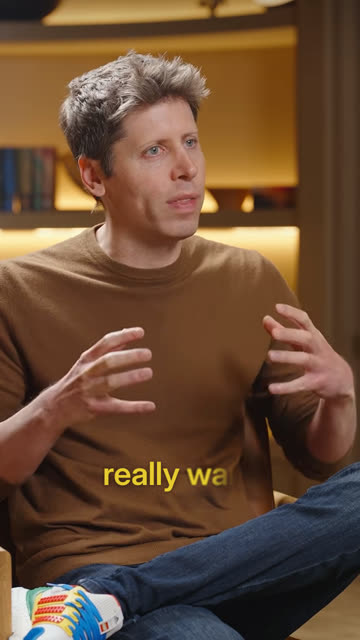<br>**whisper**<br>Lowercase warm-yellow text; each word is revealed by a soft left-to-right wipe and the page dissolves with a blur. |  |

A style is one JSON file in `styles/` plus one small component in `template/src/styles/`. Copy a preset, change the
font, colours, size or timing, and pass its path to `--style`. Some styles have colourways: `--style ticket:yellow`.
`python3 scripts/subtle.py --list-styles` prints them all.

## Use it from the command line

```bash
python3 scripts/subtle.py talk.mp4                          # glide
python3 scripts/subtle.py talk.mp4 --style glass            # frosted-glass pill
python3 scripts/subtle.py talk.mp4 --style keyword          # a giant keyword behind the speaker
python3 scripts/subtle.py talk.mp4 --style cover --legibility off --palette off   # behind a headline, preset colours
python3 scripts/subtle.py talk.mp4 --style ticket:yellow    # a colourway of a style
python3 scripts/subtle.py talk.mp4 --style accent --emphasis-words 'gold, $5,000' --vocab "Meera, RBI"
python3 scripts/subtle.py talk.mp4 --emphasis numbers       # highlight only numbers, prices, percentages and years
python3 scripts/subtle.py talk.mp4 --hinglish               # Hindi written in Latin letters
python3 scripts/subtle.py talk.mp4 --aspect 9:16            # centre-crop first
python3 scripts/subtle.py talk.mp4 --placement off --cuts off   # keep the style's own position, ignore cuts
python3 scripts/subtle.py talk.mp4 --behind off             # draw giant words in front, never behind
python3 scripts/subtle.py talk.mp4 --captions talk.captions.json   # re-render after editing the captions
```

The transcript is cached by the file's hash, so trying another style does not transcribe again.

## Limits

- The behind-the-speaker effect (`keyword`, `cover`, `outline`, `poster`, `rise`, `numeral`) works best with one person and a steady camera. Fine hair, fast hand
  movement and fast pans show at the matte edge. Subtle checks the subject first and draws the words in front when it
  would look bad.
- Styles without a container (soft-shadow text) can be hard to read on bright or busy footage; the check warns about
  low contrast and suggests `glass`, `chip` or `block`.
- Whisper spells Hindi words in Latin letters unevenly. Read the transcript before rendering and fix words with
  `--replace heard=Shown`.
- A giant number is never put behind the speaker in `keyword` (hidden digits would change it): it is drawn in front. `numeral` is built for numerals behind the speaker.
- Word timings come from Whisper's attention, not forced alignment. They are usually within a frame or two; very fast
  speech can drift.

## Licences

Subtle's code is MIT. The bundled fonts are under the SIL Open Font License. The default renderer uses
[Remotion](https://www.remotion.dev), which is free for individuals and companies of up to 3 people; larger companies
need a Remotion company licence. Details for every dependency are in [THIRD_PARTY.md](THIRD_PARTY.md).

The showcase site (`site/`) uses a third-party clip for demo only. That media is not in this repo; see
[site/README.md](site/README.md) for how to make your own.

How the pieces fit together: [docs/ARCHITECTURE.md](docs/ARCHITECTURE.md).

---

Made by [Refs](https://refs.video).
